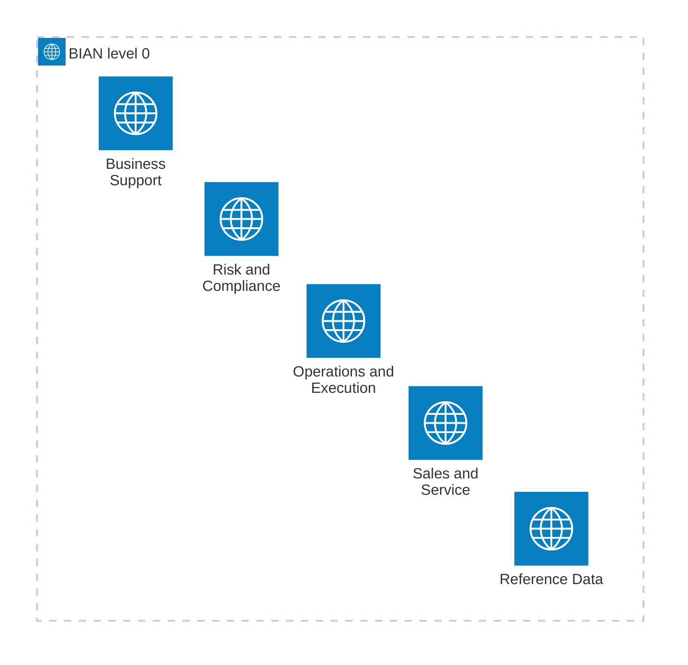

# Fintech compliance overlay (opt-in)

**Not a certification.** This overlay adds checklist prompts and light heuristics for
payment / ledger style codebases. It does **not** replace a QSA, PCI assessor, or
your bank’s control framework. Keep Semgrep/CodeQL/secret scanners in CI.

## Namespaced checklist themes

| ID | Theme | Ask |
|----|-------|-----|
| `fintech.pci_pan` | Card data | Is PAN / track data ever logged, stored, or sent in clear text? |
| `fintech.ledger_integrity` | Ledger | Are money movements append-only with immutable audit ids? |
| `fintech.webhook_auth` | Integrations | Are payment webhooks verified with constant-time HMAC / SDK verify? |
| `fintech.secrets_hsm` | Keys | Are signing keys via HSM/KMS — never hard-coded or in git? |
| `fintech.recon` | Ops | Is there a reconciliation path for failed / duplicate settlements? |

## Where these questions sit in a bank

This is not a BIAN certification. The five business areas below are level 0 of the [BIAN service landscape](https://github.com/koayact/D3js/wiki/BIAN-Service-Landscape). The questions in this overlay land in three of those areas. Reference Data and Sales and Service are drawn so the row stays the whole landscape.

| Check | Closest BIAN service domain | Business area |
|-------|-----------------------------|---------------|
| `fintech.pci_pan` | Cards | Operations and Execution, product-specific fulfillment |
| `fintech.ledger_integrity` | Account Management | Operations and Execution, cross-product operations |
| `fintech.webhook_auth` | Payments | Operations and Execution, cross-product operations |
| `fintech.recon` | Payments | Operations and Execution, cross-product operations |
| `fintech.secrets_hsm` | IT Management | Business Support |

A hint here means “look at that service domain.” It does not satisfy Regulatory Compliance, and it does not replace a QSA.

## Honesty

Findings are **due-diligence hints**. Passing this overlay ≠ PCI DSS / SOC 2 certified.
